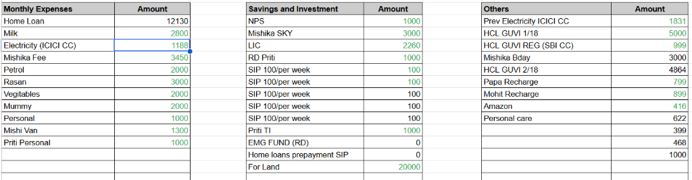
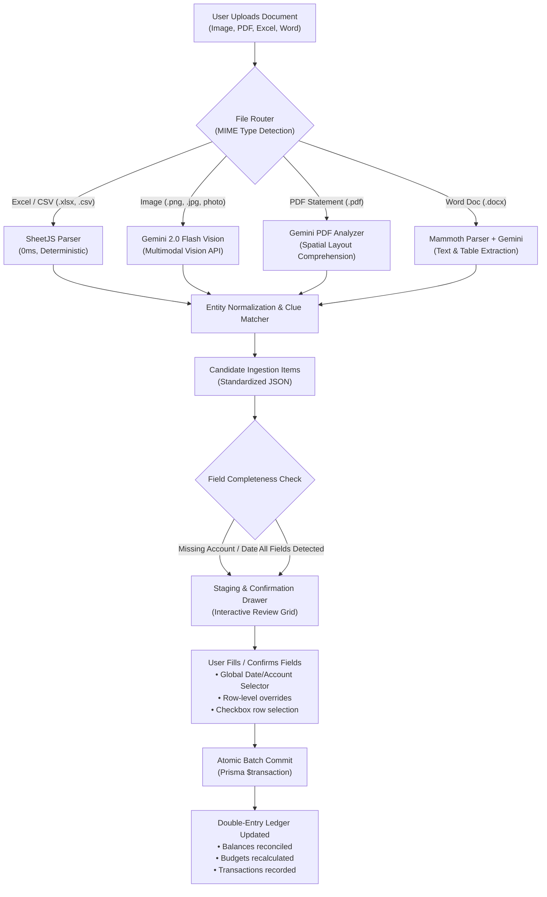
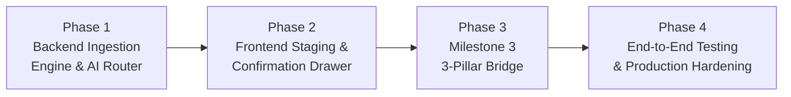

# 📄 Document Ingestion & AI Extraction Engine: Master Plan & Specification

> **File:** `DOCUMENT_INGESTION_AND_AI_EXTRACTION_PLAN.md`  
> **Target:** MoneyLens AI-Powered Personal Finance & Budget Management Platform  
> **Status:** Specification Approved & Implementation Roadmap  
> **Document Reference:** User Monthly Spreadsheet Screenshot (`docs/user_monthly_sheet_screenshot.png`)

---

## 🎯 Executive Summary

MoneyLens users track their finances across multiple formats: monthly spreadsheet screenshots, bank/credit card PDF statements, digital Excel/CSV exports, and handwritten or printed bills. 

This specification establishes an **Intelligent Multi-Format Ingestion Pipeline** combining:
1. **Deterministic Parsers** (for instantaneous, zero-cost Excel/CSV extraction)
2. **Multimodal AI (Gemini 2.0 Flash Vision)** (for reading complex screenshot grids, scanned PDFs, invoices, and receipts)
3. **Human-in-the-Loop Confirmation Drawer** (staging table where missing required fields like Account, Category, or Date are highlighted and easily completed before double-entry ledger commit)

---

## 🔍 Case Study: Analyzing the User's Monthly Spreadsheet

Based on the actual financial spreadsheet screenshot provided by the user:



### Structural Breakdown of the User's Document:
The document contains three distinct columns of financial commitments:

```
┌───────────────────────────────┬───────────────────────────────┬───────────────────────────────┐
│ 1. Monthly Expenses           │ 2. Savings and Investment     │ 3. Others (EMIs & Bills)      │
├───────────────────────────────┼───────────────────────────────┼───────────────────────────────┤
│ Home Loan:             ₹12,130│ NPS:                    ₹1,000│ Prev Electricity ICICI: ₹1,831│
│ Milk:                   ₹2,800│ Mishika SKY:            ₹3,000│ HCL GUVI 1/18:          ₹5,000│
│ Electricity (ICICI CC): ₹1,188│ LIC:                    ₹2,260│ HCL GUVI REG (SBI CC):    ₹999│
│ Mishika Fee:            ₹3,450│ RD Priti:               ₹1,000│ Mishika Bday:           ₹3,000│
│ Petrol:                 ₹2,000│ SIP 100/per week:         ₹100│ HCL GUVI 2/18:          ₹4,864│
│ Rasan:                  ₹3,000│ SIP 100/per week:         ₹100│ Papa Recharge:            ₹799│
│ Vegitables:             ₹2,000│ Priti TI:               ₹1,000│ Mohit Recharge:           ₹899│
│ Mummy:                  ₹2,000│ EMG FUND (RD):              ₹0│ Amazon:                   ₹416│
│ Personal:               ₹1,000│ Home loan prepayment:       ₹0│ Personal care:            ₹622│
│ Mishi Van:              ₹1,300│ For Land:              ₹20,000│ Miscellaneous:     ₹399, ₹468 │
│ Priti Personal:         ₹1,000│                               │ Miscellaneous:          ₹1,000│
└───────────────────────────────┴───────────────────────────────┴───────────────────────────────┘
```

### Critical Extraction Intelligence Required:
1. **Column-Based Type Mapping**:
   - Column 1 (`Monthly Expenses`) $\rightarrow$ `EXPENSE`
   - Column 2 (`Savings and Investment`) $\rightarrow$ `INVESTMENT_ALLOCATION`
   - Column 3 (`Others`) $\rightarrow$ `EXPENSE` (EMIs / One-offs / Card bills)
2. **Account Clues Embedded in Item Names**:
   - `"Electricity (ICICI CC)"` $\rightarrow$ Suggested Account: `ICICI Credit Card`
   - `"HCL GUVI REG (SBI CC)"` $\rightarrow$ Suggested Account: `SBI Credit Card`
   - `"Home Loan"` $\rightarrow$ Suggested Account: `HDFC Salary Account`
3. **Installment & Counter Detection**:
   - `"HCL GUVI 1/18"` and `"HCL GUVI 2/18"` $\rightarrow$ Notes tag: `installment: 1 of 18`, Category: `Loan/EMI`
4. **Missing Field Identification**:
   - The spreadsheet defines **monthly totals**, not individual transaction calendar dates (e.g. `2026-10-05`).
   - Double-entry ledger **requires** an `accountId` and `date`.
   - **System Response**: Present a global month/date selector (e.g. "Apply to all: October 2026") and flag rows missing accounts.

---

## ⚖️ Technology Selection: Parser vs. AI Evaluation

| Document Format | Parser Technology | AI Technology (Gemini 2.0 Flash) | Selected Strategy & Rationale |
|---|---|---|---|
| **Excel (`.xlsx`, `.xls`, `.csv`)** | SheetJS (`xlsx`) / PapaParse: Exact numbers, 0ms latency, zero API cost. | Slower, unnecessary for clean tables, potential token cost. | **Deterministic Parser**: 100% exact math. Use AI only as an optional helper for semantic category tagging. |
| **Image (`.png`, `.jpg`, mobile photo)** | Traditional OCR (Tesseract): Cannot handle multi-column tables, breaks on handwriting or screen glares. | Native Multimodal Vision: Understands multi-column tables, notes in parentheses, and currency formats with 99%+ accuracy. | **Gemini 2.0 Flash Vision**: Direct image-to-JSON extraction with strict Zod/JSON schema output. |
| **PDF (Bank / Card Statements)** | `pdf-parse`: Fails on scanned/image PDFs, loses 2D spatial table structure. | Ingests native PDFs up to 100+ pages; preserves table row/column alignment. | **Gemini PDF API**: Direct structured schema extraction. |
| **Word Doc (`.docx`)** | `mammoth`: Extracts raw text and HTML tables in $10\text{ms}$. | Converts raw text into structured JSON. | **Hybrid**: Parse text locally with Mammoth $\rightarrow$ Send text to Gemini for classification. |

---

## 🏗️ End-to-End System Architecture



---

## 📋 Data Normalization & Output Schema

The ingestion engine standardizes all parsed content into typed candidates:

```typescript
export interface IngestionCandidateItem {
  id: string; // Temporary staging ID
  rawTitle: string; // Original extracted text (e.g. "Electricity (ICICI CC)")
  cleanTitle: string; // Sanitized payee name (e.g. "Electricity")
  amount: number; // Parsed numerical amount (e.g. 1188.00)
  type: "EXPENSE" | "INCOME" | "INVESTMENT_ALLOCATION" | "TRANSFER";
  
  // Smart Inferred Fields
  suggestedAccountId?: string; // Pre-matched account ID (e.g. from "(ICICI CC)")
  suggestedAccountName?: string;
  suggestedCategoryId?: string; // Pre-matched category ID (e.g. "Utilities")
  suggestedCategoryName?: string;
  suggestedDate?: string; // YYYY-MM-DD
  notes?: string; // Tags, installment notes (e.g. "installment: 1/18")
  
  // Validation Flags
  isValid: boolean; // True if amount > 0, accountId present, date present
  missingFields: ("account" | "date" | "category")[];
}

export interface IngestionScanResult {
  fileName: string;
  fileType: string;
  totalExtracted: number;
  periodDetected?: string; // e.g. "2026-10"
  items: IngestionCandidateItem[];
  summary: {
    totalExpense: number;
    totalInvestment: number;
    totalIncome: number;
    netSum: number;
  };
}
```

---

## 🖥️ Human-in-the-Loop Confirmation UX (The Staging Drawer)

The user must never be surprised by automated entries. The staging interface provides total control:

```
┌───────────────────────────────────────────────────────────────────────────────────────────────────────┐
│ 📄 Review & Confirm Scanned Entries (24 items detected from screenshot)                              │
├───────────────────────────────────────────────────────────────────────────────────────────────────────┤
│ ⚡ Bulk Controls:                                                                                     │
│   Apply to all: [ Date: 2026-10-01 ▾ ]   [ Account: HDFC Salary Bank ▾ ]   [ ✓ Select All ]           │
├───────────────────────────────────────────────────────────────────────────────────────────────────────┤
│ [✓]  Type       Payee / Item             Amount     Category          Account              Status     │
│ ───────────────────────────────────────────────────────────────────────────────────────────────────── │
│ [✓]  EXPENSE    Home Loan                ₹12,130    Housing ▾         HDFC Salary Bank ▾   ✓ Ready    │
│ [✓]  EXPENSE    Electricity (ICICI CC)   ₹1,188     Utilities ▾       ICICI Credit Card ▾  ✓ Ready    │
│ [✓]  INVESTMENT Mishika SKY              ₹3,000     Investments ▾     HDFC Salary Bank ▾   ✓ Ready    │
│ [✓]  EXPENSE    HCL GUVI 1/18            ₹5,000     Loans & EMIs ▾    ⚠️ Choose Account ▾  Needs Acc  │
│ [✓]  EXPENSE    Rasan                    ₹3,000     Groceries ▾       Cash Wallet ▾        ✓ Ready    │
│ [✓]  INVESTMENT For Land                 ₹20,000    Sinking Fund ▾    HDFC Salary Bank ▾   ✓ Ready    │
├───────────────────────────────────────────────────────────────────────────────────────────────────────┤
│ Summary: 19 Expenses (₹48,220) | 5 Investments (₹27,360) | Total Outflow: ₹75,580                    │
│ [ Cancel ]                                         [ Commit 24 Entries to October 2026 Ledger ➔ ]    │
└───────────────────────────────────────────────────────────────────────────────────────────────────────┘
```

### Key UX Features:
1. **1-Click Global Default Toolbars**: Set account or date for 20 items in one second.
2. **Visual Row Status Indicators**:
   - `✓ Ready` (Green): All double-entry criteria met.
   - `⚠️ Needs Account` (Amber): Missing account selection.
   - `⚠️ Needs Date` (Amber): Missing transaction date.
3. **Atomic Commit**: The button is active only when all checked rows have valid accounts and dates.
4. **Row Exclusion**: Uncheck any row to skip it without deleting it from your source document.

---

## 🚀 Step-by-Step Implementation Roadmap



### Phase 1: Backend Extraction & Router Engine
- [ ] **1.1 File Upload & Route Middleware**: Configure `multer` with memory buffer storage supporting `.png, .jpg, .jpeg, .pdf, .xlsx, .xls, .csv, .docx`.
- [ ] **1.2 Excel/CSV Parser Service**: Integrate `xlsx` to parse spreadsheet tables and headers dynamically into standardized rows.
- [ ] **1.3 Gemini 2.0 Flash Multimodal Vision Service**:
  - Integrate `@google/genai` with `GEMINI_API_KEY`.
  - Provide system instruction for receipt/sheet transcription with strict JSON schema.
- [ ] **1.4 Word Document Parser**: Integrate `mammoth` for text and HTML table extraction from `.docx`.
- [ ] **1.5 Smart Entity & Clue Matcher**:
  - Keyword account detector (e.g. `ICICI CC` $\rightarrow$ maps to user's ICICI Credit Card).
  - Category fuzzy matcher (e.g. `Petrol` $\rightarrow$ `Transportation`, `Milk`/`Rasan` $\rightarrow$ `Food/Groceries`).
  - Installment regex parser (e.g. `1/18` $\rightarrow$ tags `installment_1_of_18`).
- [ ] **1.6 Atomic Batch Ingestion API**:
  - `POST /api/v1/ingestion/scan`: Receives file, executes router, returns normalized candidate items.
  - `POST /api/v1/ingestion/commit`: Accepts confirmed items array, executes Prisma `$transaction` batch insert with atomic account balance reconciliation.

### Phase 2: Frontend Staging & Confirmation Drawer
- [ ] **2.1 Drag-and-Drop Ingestion Zone**:
  - Accepts image drops, file browsing, and clipboard paste (Ctrl+V screenshot).
- [ ] **2.2 Staging Confirmation Drawer / Modal**:
  - Full-width review drawer with filterable status tabs (`All`, `Needs Attention`, `Ready`).
  - Inline editable fields: Type, Payee, Amount, Category selector, Account selector, Date picker.
- [ ] **2.3 Global Bulk Toolbar**:
  - "Set Date for all selected"
  - "Set Account for all selected"
  - "Select / Deselect all"
- [ ] **2.4 Ledger Commit Action**:
  - Submits valid items, triggers global `moneylens:transaction-created` event, and refreshes the ledger seamlessly.

### Phase 3: Integration with Expenses & Milestone 3 Dashboard
- [ ] **3.1 Header & Page Actions**:
  - Add **"Scan Bill / Sheet"** action button in Topbar and on `/expenses`.
- [ ] **3.2 User Financial Blueprint Integration**:
  - Direct bridge to the 3 Pillars:
    - Automatically classifies items into **Pillar 1** (Monthly Expenses), **Pillar 2** (Savings & Investment), and **Pillar 3** (Others & EMIs).

### Phase 4: Automated Testing & Verification
- [ ] **4.1 Unit Tests**: Test SheetJS parsing on test `.xlsx` files and entity normalization logic.
- [ ] **4.2 Gemini Mock Tests**: Test image JSON extraction with mock Gemini responses.
- [ ] **4.3 Batch Ledger Tests**: Verify that committing 25 transactions accurately updates balances across multiple accounts simultaneously without partial failures.

---

## 🔒 Security, Privacy & Accuracy Guarantees

1. **Ephemeral File Processing**: Files uploaded for scanning are processed in memory and never permanently written to disk unless the user explicitly requests receipt attachment.
2. **Zero-Hallucination Policy**: If the AI is uncertain about an amount or title, it sets `confidence: "low"` and flags the row for explicit user confirmation in the staging table.
3. **Double-Entry Enforcement**: No entry can bypass account selection. Every transaction committed must link to a valid `accountId`, preserving mathematical balance integrity.

